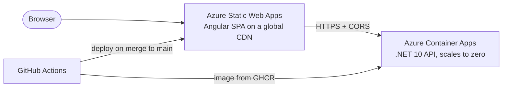

# SmartLedger

AI-powered expense and invoice manager. Snap a receipt, let AI extract the vendor, date, amounts and line items, review and approve, then see where the money goes.

[](https://github.com/0AbdullahSajjad0/SmartLedger/actions/workflows/ci-cd.yml)

**Live demo:** https://red-coast-0ea7ce800.5.azurestaticapps.net
**API health:** https://ca-smartledger-api.kindfield-c023326b.centralindia.azurecontainerapps.io/health

> The API scales to zero when idle to stay within free hosting limits, so the first request after a quiet period can take up to ~30 seconds while it starts.

## Status

The project is being built in phases, each one deployed to production as it lands.

- [x] **Phase 0: Foundation.** Clean Architecture backend, Angular frontend, CI/CD to Azure
- [ ] **Database.** EF Core with Azure SQL
- [ ] **Authentication.** Register and log in with JWT
- [ ] **Receipt upload.** Image storage on Cloudflare R2
- [ ] **AI extraction.** Gemini reads receipts into structured data, with a review-and-approve step
- [ ] **Categories and reports.** Spending dashboard and charts
- [ ] **AI insights.** Monthly spending summaries

## Architecture



The backend follows Clean Architecture. Dependencies point inward, and the compiler enforces it through project references:

```
backend/src/
├── SmartLedger.Api             Controllers, middleware, composition root
├── SmartLedger.Application     Use cases, DTOs, interfaces (repositories, AI, storage)
├── SmartLedger.Domain          Entities and business rules, no dependencies
└── SmartLedger.Infrastructure  EF Core, external services (implements Application interfaces)
```

## Tech stack

| Area | Technology |
|---|---|
| Backend | .NET 10, ASP.NET Core Web API, ProblemDetails error handling, health checks, Scalar API docs |
| Frontend | Angular 22 (standalone, zoneless, signals), TypeScript, SCSS |
| Testing | xUnit with `WebApplicationFactory` integration tests, Vitest |
| Hosting | Azure Container Apps (API), Azure Static Web Apps (frontend) |
| Container | Multi-stage Dockerfile, chiseled non-root runtime image, published to GitHub Container Registry |
| CI/CD | GitHub Actions with change detection, OIDC login to Azure (no stored credentials), post-deploy smoke test |

## Running locally

**Prerequisites:** [.NET 10 SDK](https://dotnet.microsoft.com/download/dotnet/10.0) and [Node.js](https://nodejs.org/) 24.15 or later.

**API** (http://localhost:5217, API docs at `/scalar`):

```bash
cd backend
dotnet run --project src/SmartLedger.Api
```

**Frontend** (http://localhost:4200, calls the local API):

```bash
cd frontend
npm ci
npm start
```

**Tests:**

```bash
cd backend
dotnet test SmartLedger.slnx
```

```bash
cd frontend
npx ng test --watch=false
```

## CI/CD

A single workflow ([`ci-cd.yml`](.github/workflows/ci-cd.yml)) runs on every pull request and every push to `main`:

1. **Detect changes:** backend and frontend jobs only run when their folder changes.
2. **Build and test:** .NET build with warnings as errors plus tests; Angular tests and production build.
3. **Package:** the API is built into a Docker image tagged with the commit SHA.
4. **Deploy** (`main` only): the API image goes to Azure Container Apps and is smoke-tested on `/health`; the Angular build is uploaded to Azure Static Web Apps.
5. **CI result:** one summary check that branch protection requires before merging.

## License

[MIT](LICENSE)
